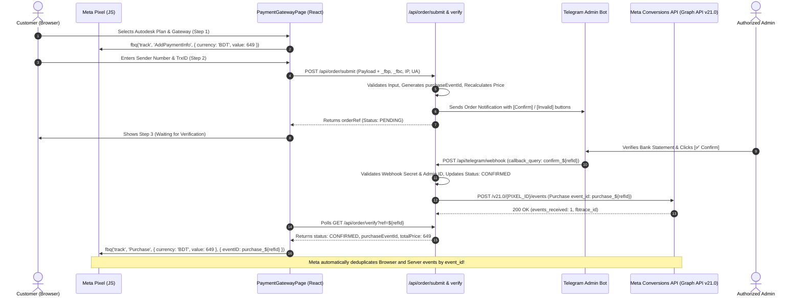

# Meta Conversions API (CAPI) & Pixel Setup Guide
**Software Solutions BD — Autodesk Subscriptions**

---

## 1. Overview & Architecture

This implementation combines **Meta Pixel (Client-Side)** and **Meta Conversions API (Server-Side)** to deliver a redundant, deduplicated, and privacy-compliant conversion tracking architecture.

---

## 2. Event-to-Business-Action Mapping

The implementation tracks the five standard Meta Events Manager events corresponding to genuine business milestones:

| Meta Event | Trigger Action | Location in Code | Shared Event ID | Attribution / Matching Data |
| :--- | :--- | :--- | :--- | :--- |
| **`ViewContent`** | User views or selects a specific subscription package | [`src/components/SubscriptionPlans.jsx`](file:///c:/Users/irfan/Desktop/SSolutions/src/components/SubscriptionPlans.jsx) | N/A (Browser) | `content_name`, `content_ids`, `value` (BDT), `currency` |
| **`Contact`** | User clicks WhatsApp support buttons across the site | [`src/components/FloatingContactButton.jsx`](file:///c:/Users/irfan/Desktop/SSolutions/src/components/FloatingContactButton.jsx), [`ContactSection.jsx`](file:///c:/Users/irfan/Desktop/SSolutions/src/components/ContactSection.jsx), [`NotFoundPage.jsx`](file:///c:/Users/irfan/Desktop/SSolutions/src/components/NotFoundPage.jsx) | N/A (Browser) | `content_name: 'WhatsApp Support'`, `channel: 'WhatsApp'` |
| **`InitiateCheckout`** | User completes order form and proceeds to payment | [`src/components/OrderSection.jsx`](file:///c:/Users/irfan/Desktop/SSolutions/src/components/OrderSection.jsx) | N/A (Browser) | `content_name`, `num_items`, `value` (BDT), `currency` |
| **`AddPaymentInfo`** | User selects gateway (bKash/Nagad/Rocket) & enters phone | [`src/components/payment/PaymentGatewayPage.jsx`](file:///c:/Users/irfan/Desktop/SSolutions/src/components/payment/PaymentGatewayPage.jsx) | N/A (Browser, **1x deduplicated**) | `payment_method`, `value` (BDT), `currency` |
| **`Purchase`** | **Authorized admin confirms verified payment receipt** | **Browser**: [`PaymentGatewayPage.jsx`](file:///c:/Users/irfan/Desktop/SSolutions/src/components/payment/PaymentGatewayPage.jsx) **Server**: [`api/telegram/webhook.js`](file:///c:/Users/irfan/Desktop/SSolutions/api/telegram/webhook.js) & [`api/_lib/metaCapi.js`](file:///c:/Users/irfan/Desktop/SSolutions/api/_lib/metaCapi.js) | **`purchase_${refId}`** *(Exact Match)* | Hashed `em`, `ph`, unhashed `client_ip_address`, `client_user_agent`, `fbp`, `fbc`, `order_id`, `value` (BDT) |

---

## 3. Environment Variables Configuration

Configure these variables privately in your **Vercel Project Dashboard** (`Settings` → `Environment Variables`):

### Server-Side Private Variables (Backend Only)
*Never prefix these with `VITE_`! They are accessible only by Vercel Serverless Functions.*

| Variable | Value / Description | Example |
| :--- | :--- | :--- |
| `META_PIXEL_ID` | Your Meta Dataset / Pixel ID | `6925345297741031` |
| `META_CAPI_ACCESS_TOKEN` | Private System User Access Token from Meta Events Manager | `EAAN...` *(Generated privately by Owner)* |
| `META_GRAPH_API_VERSION` | Supported Graph API Version (defaults to `v21.0`) | `v21.0` |
| `META_TEST_EVENT_CODE` | *(Staging/Testing only)* Code from Meta Events Manager Test Events tab | `TEST12345` |
| `TELEGRAM_BOT_TOKEN` | Bot token from @BotFather | `8879982228:AAEVh...` |
| `TELEGRAM_ADMIN_CHAT_ID` | Admin chat ID for notifications | `5696241698` |
| `ALLOWED_ADMIN_IDS` | Telegram User IDs authorized to click [Confirm] / [Invalid] | `5696241698` |
| `TELEGRAM_WEBHOOK_SECRET` | Secret token verifying incoming Telegram webhooks | `software_solutions_bd_secret_2026` |

### Client-Side Public Variables (Frontend Build)
*Bundled into static frontend assets by Vite.*

| Variable | Value / Description | Example |
| :--- | :--- | :--- |
| `VITE_FB_PIXEL_ID` | Meta Dataset / Pixel ID (Public Identifier) | `6925345297741031` |

---

## 4. How to Generate a Replacement Meta CAPI Access Token

1. Go to **[Meta Events Manager](https://business.facebook.com/events_manager2/)**.
2. Select your Dataset / Pixel: **`6925345297741031`**.
3. Navigate to **Settings** → scroll down to **Conversions API**.
4. Under **"Set up direct integration"**, click **Generate access token**.
5. Copy the generated token immediately.
6. Paste it into your **Vercel Project Environment Variables** as:
   `META_CAPI_ACCESS_TOKEN`.
7. Redeploy the project on Vercel.

---

## 5. Pixel & CAPI Deduplication Verification Guide

Meta deduplicates events when both the browser Pixel event and server CAPI event share:
1. `event_name` (e.g., `'Purchase'`)
2. `event_id` (e.g., `'purchase_SOFT-ATD-882194A1'`)

### How to verify deduplication in Meta Events Manager:
1. In Meta Events Manager, click **Test Events**.
2. Copy your **Test Event Code** (e.g. `TEST12345`).
3. Set `META_TEST_EVENT_CODE=TEST12345` in Vercel or local test environment.
4. Place a test order and have the admin click `[✅ Confirm]`.
5. In Meta Events Manager **Test Events** feed:
   - You will see two entries: one with connection method **Browser** and one with connection method **Server**.
   - Both will display the identical Event ID: `purchase_SOFT-ATD-...`.
   - Meta will label them as **Deduplicated** with a green badge.
6. Once verified, delete or unset `META_TEST_EVENT_CODE` for production.

---

## 6. Durable Outbox & Database Architecture

The application implements a durable outbox pattern:
- **Local / Serverless Storage**: File-backed JSON store in `/tmp/adesk_orders.json` ensures records survive serverless function warm cycles.
- **Outbox State Machine**: Every confirmed purchase queues an entry in `capiOutbox` (`PENDING`, `DISPATCHED`, `FAILED`).
- **Production Distributed Database**: For high-volume multi-region serverless deployment, the store is architected to seamlessly interface with **Upstash Redis** (`KV_REST_API_URL`) or **Supabase / PostgreSQL**.
